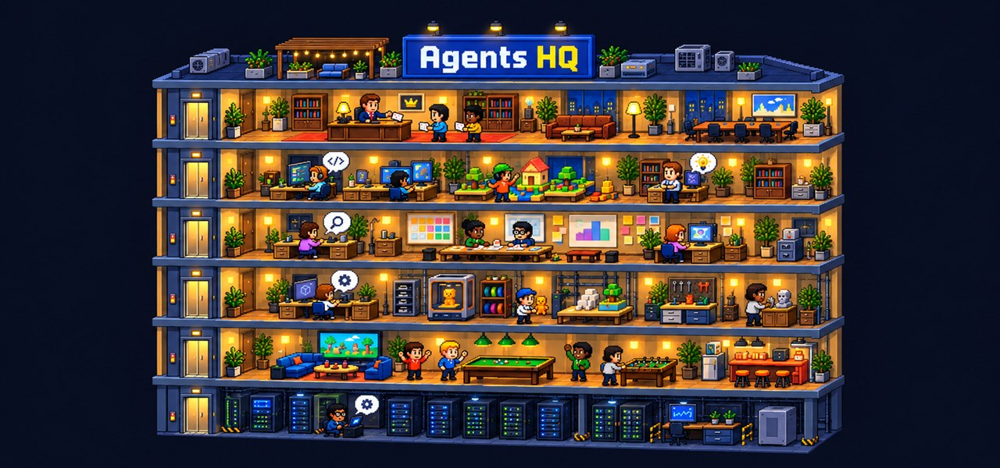

# QG des agents

**Un immeuble d'agents Claude qui travaillent pour toi, en pixel art.**
Tu écris une demande au DG (le directeur) ; il la découpe en tâches, choisit pour chacune le bon modèle (Opus, Sonnet, Haiku, Fable) et le bon niveau de réflexion, puis des agents travaillent en parallèle, un étage par projet. Tu les regardes réfléchir, tu réponds à leurs questions, tu valides ce qui doit l'être.
Les agents peuvent tourner sur Claude, sur **Codex** (ChatGPT) ou sur d'autres agents compatibles ACP (Grok, Cursor, Copilot, Gemini…) : voir « Multi-IA ».

|  |  |  |
|:---:|:---:|:---:|
| Le DG découpe ta demande et distribue les tâches | Les agents se passent le relais en réunion | Ceux qui attendent leur tour jouent en salle de pause |

*English below.*

---

## Ce qu'il faut
- **Windows 10 ou 11, 64 bits**, ou **macOS 13 ou plus** (Apple Silicon ou Intel ; voir « Installer sur Mac »).
- **Au moins un compte d'IA**, au choix : un abonnement Claude (Pro, Max, Team ou Enterprise) ou une clé API Anthropic ; un compte Codex (abonnement ChatGPT ou clé API OpenAI) ; un agent compatible ACP (Grok, Cursor, Copilot, Gemini…). Un seul compte suffit : il prend alors tous les rôles.
- Une connexion Internet. L'installation télécharge ce qu'il faut (≈ 250 Mo), tout reste dans le dossier du QG.
- Conseillé : **Git pour Windows** (l'installation propose de l'installer). Les agents s'en servent pour lancer des commandes.
- Facultatif : une **carte NVIDIA** pour la dictée locale rapide.

## Installer
1. Télécharge `QG-des-agents-<version>.zip` dans **[Releases](../../releases)**.
2. Avant d'extraire : clic droit sur le zip › **Propriétés** › coche **Débloquer** › OK (sinon Windows peut bloquer les fichiers .bat venus d'Internet).
3. Extrais-le dans un dossier simple, par exemple `C:\QG-des-agents` (évite OneDrive et les chemins très longs).
4. Double-clic sur **`installer.bat`**. Il installe Node.js en version portable (dans `runtime\node`), Claude Code (l'outil officiel d'Anthropic, via le SDK) et vérifie Git. Chaque téléchargement est vérifié par son empreinte SHA-256.
5. Le QG s'ouvre dans ton navigateur et une **configuration guidée** t'accompagne :
   - langue de l'interface et langue des IA ;
   - connexion à ton compte Claude (une petite fenêtre puis ton navigateur : le QG ne voit jamais ton mot de passe ni ton jeton) ;
   - choix de tes dossiers de projets (ex. `D:\Dev`, `D:\IA`) : chaque projet trouvé peut devenir un étage ;
   - mode de travail des agents ;
   - dictée et notifications.

Ensuite, pour lancer le QG : **`lancer.bat`** (ou le raccourci du bureau). Laisse sa fenêtre ouverte : la fermer arrête le QG. Le bouton **Fermer**, en haut à droite, fait la même chose depuis le site et ferme aussi cette fenêtre.

## Installer sur Mac
*(macOS 13 ou plus, Apple Silicon ou Intel. Même zip que pour Windows : il contient les scripts des deux systèmes.)*
1. Télécharge `QG-des-agents-<version>.zip` dans **[Releases](../../releases)** et double-clique dessus pour l'extraire. Range le dossier `QG-des-agents` dans ton dossier personnel (par exemple `~/QG-des-agents`), pas dans Téléchargements ni dans iCloud Drive.
2. Ouvre **Terminal** (Applications › Utilitaires), tape `bash ` (avec un espace), glisse `installer.command` dans la fenêtre, puis appuie sur Entrée.
   *(Lancer l'installation avec `bash` évite l'alerte « Apple n'a pas pu vérifier… » de Gatekeeper : les fichiers extraits d'un zip téléchargé sont en quarantaine. L'installation retire ensuite cette quarantaine pour tout le dossier du QG, donc les autres `.command` s'ouvrent d'un double-clic.)*
   Elle installe Node.js en version portable (dans `runtime/node`, pour ton processeur), Claude Code (via le SDK, avec le binaire Mac) et vérifie git (outils en ligne de commande d'Apple : `xcode-select --install` si besoin). Chaque téléchargement est vérifié par son empreinte SHA-256.
3. Ensuite : double-clic sur **`lancer.command`**. Laisse la fenêtre Terminal ouverte : la fermer arrête le QG. `lancer-demo.command`, `ajouter-un-compte.command` et `mettre-a-jour.command` remplacent les `.bat` du même nom.

Si tu as double-cliqué `installer.command` et que macOS l'a bloqué : Réglages Système › Confidentialité et sécurité › en bas, « Ouvrir quand même » (depuis macOS Sequoia, le Ctrl-clic › Ouvrir ne suffit plus).

Ce qui change sur Mac : la connexion des comptes passe par le trousseau de macOS (le QG interroge Claude Code pour savoir si un compte est connecté) ; la dictée locale (Whisper) n'est pas encore disponible, la dictée de macOS (touche micro, ou fn deux fois) marche dans la zone de saisie ; la notification système (quand aucun onglet n'est ouvert) apparaît au nom de l'Éditeur de scripts. Terminal demandera l'accès à tes dossiers (Documents, Bureau) la première fois qu'un agent y lit.

## Au quotidien
- **Écrire une demande** : en bas de l'écran, Entrée pour envoyer. Joins des captures (📎, Ctrl+V ou glisser-déposer), dicte avec 🎤 (Alt+M). Choisis le compte de la demande (menu déroulant) et, pour un nouveau dossier, son coût (pastille « Coût »). La roue ⚙ à côté d'« Envoyer » ouvre Réglages › Priorités : le compte, le modèle et l'effort du DG, tes consignes, qui fait quoi.
- **Se déplacer** : ◀ ▶ ou Page précédente / suivante ; la colonne de gauche montre tout l'immeuble.
- **Suivre un agent** : clique sur lui pour sa fiche, sa réflexion en direct et son terminal.
- **Répondre** : la cloche 🔔 liste ce qui t'attend (autorisations, questions à choix, validations, nouveaux projets).
- **Choisir où va ton message** : le menu à côté d'« Envoyer » propose « Nouveau dossier », « Ajouter au dossier D3 » ou « Répondre au DG ». Un ajout est transmis aux agents, même s'ils travaillent déjà.
- **Parler à un agent sans le couper** : dans sa fiche, « Demander où il en est » (une copie de sa conversation te répond, son travail continue) ou « Nouvelle consigne » (elle lui arrive en direct).
- **Salle de pause et salle de repos** : les agents qui attendent leur tour jouent en salle de pause (billard, baby-foot, télé) ; ceux qui ont fini dorment en salle de repos, prêts à être réembauchés avec tout leur contexte.
- **📄 Documents** : les fichiers `.md` produits par les agents, mis en forme (titres, gras, tableaux…), du plus récent au plus ancien. Les fichiers cités dans les messages s'ouvrent d'un clic.
- **⚡ Consommation** : tokens du jour, limites de ton forfait (fenêtre de 5 h, semaine, par modèle), détail par compte, modèle, étage et dossier, et les tokens économisés grâce au cache.
- **🌐 Navigateur** : une fenêtre dans le QG, en deux modes. *Simple* : vidéos et directs (YouTube, Twitch, Kick) joués ici, les autres sites dans une fenêtre de ton navigateur, avec tes comptes. *Complet* : tous les sites ici (Google, Docs, Reddit…), recherche Google, avec une session propre au QG (tu te connectes une fois, c’est gardé) ; il installe une fois le navigateur intégré (≈ 100 Mo) et marche aussi si ton navigateur habituel est Brave, Firefox…
- **Arrêt d'urgence** : coupe tout, tout de suite.
- **Fermer** (à côté) : arrête les agents en enregistrant tout, puis ferme le serveur et sa fenêtre ; les dossiers en cours reprennent au prochain lancement.
- **Archiver un dossier** : dans l'onglet Dossiers, un dossier terminé, annulé ou en échec peut être rangé avec « Archiver ». Il quitte la liste, les fiches et le fil, sans rien effacer ; rien ne s'archive tout seul.
- **Panneau de droite** : élargis-le en tirant son bord gauche ; agrandis la zone de saisie en tirant son bord haut ; A− / A+ pour la taille du texte.

## Réglages (⚙, en haut à droite)
Tout se règle dans le site, sans toucher aux fichiers. Chaque réglage a un petit « i » qui explique ce qu'il fait, avec des exemples :
- **Général** : langues, ton prénom, mode de travail (autonome ou prudent), coût des nouvelles demandes, parallélisme, affichage.
- **Comptes IA** : autant de comptes que tu veux (perso, pro…), Claude, Codex ou autres agents (ACP), renommables ; connexion, déconnexion, compte par défaut. Pour Claude, aussi possible avec `ajouter-un-compte.bat`.
- **Priorités** : le DG (compte, modèle, effort), tes consignes au DG (une générale et une par type de tâche), quel compte fait quoi (code, recherche, rédaction, images, vérification, ambiance), les images et les limites d'usage (pause, autre compte libre, comptes de remplacement). Chaque ligne a son « i » qui l'explique, avec des exemples (voir « Multi-IA »).
- **Dossiers et étages** : tes dossiers racines, les projets détectés (et chaque racine elle-même, à utiliser comme étage entier), les étages (renommer, activer, fiche du projet pour le DG, ajouter ou retirer des dossiers). **＋ Nouvel étage** (aussi en haut de la colonne de l'immeuble) crée un étage à la volée : un nom, un type (dans la liste ou écrit par toi ; vide, le type détecté) et un ou plusieurs dossiers, même sans projet détecté.
- **Dossiers archivés** : les dossiers rangés avec « Archiver ». Chaque tâche (T1, T2…) rouvre sa fiche en lecture seule ; « Ressortir » remet le dossier dans l'onglet Dossiers.
- **Connecteurs MCP** : les connecteurs de ton compte claude.ai (Notion, Drive…) et les MCP de tes projets, coupés par défaut ; « Sur demande » ou « Auto » un par un.
- **Équipe et skins** : tous les personnages en image ; nom (modifiable en direct, même au travail) et apparence de chacun, du DG et de Joy ; ajout et retrait de personnages.
- **Git** (dans Général) : laisser les agents faire pull, commit, merge et push sans demander, si tu le souhaites.
- **Happiness manager** : les blagues et anecdotes que Joy raconte aux agents qui attendent ; export et import en **Excel**, CSV ou JSON, édition directe.
- **Dictée et notifications** : installation de la dictée locale (Whisper, gratuite, sur ton PC).

## Coût
Réglages › Général › **Coût** fixe le niveau des nouvelles demandes. La pastille de la barre d'envoi le change pour un nouveau dossier (💰 quand la barre est étroite). Le niveau est figé à la création du dossier et s'affiche sur sa fiche (« Coût : Équilibré »).
- **Économe** — le minimum qui donne un bon résultat : 4 tâches au plus, rien en dehors de la demande ; l'agent vérifie lui-même son travail avec des commandes concrètes (tests, build), et un vérificateur ne passe que sur une tâche risquée ou une relecture demandée ; ton accord est demandé si le plan dépasse 25 % de ce qui reste de ta fenêtre de 5 h.
- **Équilibré** (défaut) — le juste coût : 8 tâches au plus, un vérificateur pour le code partagé ou critique, ton accord au-delà de 60 %.
- **Max** — qualité d'abord, sans regarder la dépense : 12 tâches au plus, un vérificateur pour toute tâche qui modifie du code, jamais d'accord demandé.

Les économies qui ne coûtent rien en qualité sont actives à tous les niveaux : les longues sessions sont compactées, le vérificateur reprend sa session après une correction, une tâche passe son résultat à la suivante par un livrable complet. **Personnalisé**, le 4e choix, part des valeurs d'un niveau : chaque valeur se change et a son « i ». Choisir ensuite un niveau garde tes valeurs de Personnalisé : tu les retrouves en revenant sur Personnalisé.

**Ce qui ne change jamais**, quel que soit le niveau : le modèle et l'effort des agents et du DG (le choix du DG, et le tien pour le DG), l'ordre des tâches (une tâche qui dépend d'une autre attend qu'elle soit terminée et vérifiée), le parallélisme, les règles de sécurité et les approbations.

**Lire l'estimation** : avant le lancement, la carte du plan affiche par exemple « ≈ 12 $ · ≈ 15 % de ta fenêtre de 5 h (il en reste 60 %) ».
- Le montant est en **équivalent API**, le prix des mêmes jetons facturés à l'unité. Avec un abonnement, tu ne le paies pas : il sert à comparer.
- Le % est la part de ta fenêtre de 5 h que le plan devrait prendre. Le QG apprend sur ton compte combien de % vaut 1 $ (onglet ⚡) ; avant, il part d'une valeur par forfait. Si les limites du compte ne sont pas lisibles : « non estimable pour ce compte ».
- C'est un ordre de grandeur, tiré de tes tâches passées. Au-delà du seuil du niveau, la cloche 🔔 te demande « Lancer », « Réduire » (le DG refait un plan plus court, sans baisser les modèles ni les efforts) ou « Annuler ».
- Après coup, ⚡ Consommation montre pour chaque dossier « profil · estimé · réel · écart », et chaque fiche de tâche montre son contexte et ses compactions.

Les gains annoncés pour chaque niveau sont des estimations, pas encore mesurées sur de vrais dossiers : le détail est dans `docs/cout/`.

## Affichage / Graphismes
Réglages › Général › Affichage › **Graphismes**, en 5 niveaux :
- **Automatique** (défaut) : Équilibré au plus. Le QG passe en Léger sur batterie, avec un rendu sans GPU, un GPU intégré sur un écran très défini, 4 cœurs ou moins, 2 Go de mémoire ou moins, ou si les images sont lentes à dessiner. Il affiche le niveau retenu et pourquoi, par exemple « Automatique (Léger) — sur batterie ». Si la machine peine pendant l'usage, il descend d'un cran.
- **Léger** : 15 images/s, résolution réduite, animations calmes. Pour les petites machines.
- **Équilibré** : 30 images/s, résolution plafonnée, animations allégées.
- **Haute** : 60 images/s, pleine résolution.
- **Maximum** : rythme de l'écran, toujours dessiné, même onglet caché.

Sauf en Maximum, rien n'est dessiné quand l'onglet est caché, et le QG ralentit à 5 images/s quand sa fenêtre n'est pas au premier plan ou que personne ne s'en sert ; il repart dès que la souris bouge ou que quelque chose bouge dans la scène.

Le réglage est **propre à chaque appareil** : il est gardé dans le navigateur, rien n'est envoyé au serveur. Un portable peut rester en Léger pendant que le PC fixe est en Haute.

## Multi-IA
Réglages › **Comptes IA** accepte trois sortes de comptes :
- **Claude** : abonnement (Pro, Max, Team, Enterprise) ou clé API Anthropic.
- **Codex** (OpenAI) : abonnement ChatGPT (Plus, Pro, Business…) ou clé API OpenAI. Codex s'installe à la demande, depuis Réglages › Comptes IA, quand tu ajoutes un compte Codex (version 0.164.0). Un agent Codex n'écrit que dans les dossiers de sa tâche, réseau coupé, et ne peut pas commiter (`.git` en lecture seule) ; tes clés, identifiants, navigateurs et autres comptes d'IA lui sont fermés.
- **Autres agents** (protocole ACP) : Grok, Cursor, Copilot, Gemini, Mistral, Qwen, Kimi, OpenCode, Goose, ou une commande à toi. Le QG décide de chaque autorisation, ne répond jamais « toujours autoriser » et refuse les modes qui sautent les demandes ; écrire hors du projet te demande ton accord, comme pour Claude.

**Qui fait quoi** : Réglages › **Priorités** range tes comptes par type de tâche (code, recherche, rédaction, images, autres), pour le vérificateur et pour l'ambiance (Joy, mini-jeu), et règle le DG : son compte, son modèle et son effort (le coût de la demande n'y touche jamais). Listes vides : le compte de la demande (celui choisi en bas de l'écran). Avec un seul compte, il fait tout (DG, agents, vérificateur, questions, Joy), même sans aucun compte Claude.

**Consignes au DG** (dans Priorités, valables même avec une seule IA) : une consigne générale (méthode, style, choix d'IA) et une par type de tâche. Le DG suit la générale et applique celle du type ; le QG recopie celle du type dans les instructions de chaque agent de ce type et de son vérificateur. Les consignes sont figées à l'envoi de la demande.

**Limite d'usage atteinte** : dès que deux comptes sont connectés (deux comptes Claude, ou Claude et une autre IA), ce compte se met en pause jusqu'à sa remise à zéro et les autres continuent (Quota › Limite d'usage atteinte peut aussi mettre tout le QG en pause) ; avec un seul compte, tout le QG attend la remise à zéro. Par défaut, la cloche 🔔 te propose « Attendre » ou « Passer sur {compte} », avec un avertissement. Dans Réglages › Priorités › Quota › Autre compte libre, tu peux aussi laisser le QG passer tout seul sur un compte libre, ou ne jamais changer de compte ; « Comptes de remplacement » dit dans quel ordre essayer les autres comptes.

**Images** (Réglages › Priorités › Images ; la délégation est coupée par défaut) : un agent peut confier une image à Codex (abonnement ChatGPT) ou à l'API Images d'OpenAI (facturée, avec un plafond mensuel en $). Tu fixes le nombre d'images par projet ou par étage, et si ton accord est demandé à chaque fois.

**Pas encore garanti** :
- Codex et les agents ACP n'ont été **essayés qu'avec des simulations** : aucun vrai compte Codex ni aucun vrai agent ACP n'a encore tourné. Les agents ACP portent le badge « pas encore qualifié » et passent après les autres comptes quand il y a le choix. Essaie d'abord sur un petit projet.
- Les tâches « ops » (accord action par action) restent sur Claude : Codex et les agents ACP les refusent, comme toute écriture en mode prudent.
- L'estimation du coût est en $ pour Claude, en jetons pour Codex ; pour un agent ACP, en $ ou en jetons s'il les donne, sinon « non estimable pour ce compte ».

## Sécurité et confidentialité
- Le QG tourne **sur ton PC uniquement** (`127.0.0.1`), protégé par un jeton local. Aucune télémétrie, rien n'est envoyé ailleurs qu'aux IA de tes comptes.
- Les agents utilisent **Claude Code** (ou Codex, ou ton agent ACP), avec ta connexion. En mode autonome (recommandé), ils lisent partout et écrivent librement **dans tes dossiers racines** ; écrire ailleurs leur demande ton accord.
- **Toujours interdit** sans toi : `git push`, publication (npm, Rojo), arrêt du PC, registre Windows, modification du QG lui-même, lecture de tes identifiants (Claude, Codex et les autres).
- Tes réglages (`config\*.json`), l'historique (`dossiers\`) et les données de travail (`runtime\`) restent sur ton PC et ne sont jamais publiés.
- Le QG pilote Claude Code avec **ton propre compte** : respecte les conditions d'utilisation d'Anthropic. Pour un usage intensif ou partagé, une clé API (facturée au token) est l'option prévue par Anthropic.

## Mettre à jour, désinstaller
- **Mettre à jour** : ferme le QG, puis double-clic sur `mettre-a-jour.bat` (télécharge la dernière version, vérifie son empreinte, garde tes réglages).
- **Désinstaller** : supprime le dossier du QG. Les connexions des comptes sont dans `%USERPROFILE%\.claude-qg` (supprime-le aussi si tu veux).

## Dépannage
- **« Windows a protégé votre ordinateur »** : clique « Informations complémentaires » › « Exécuter quand même », ou débloque le zip avant d'extraire (voir Installer).
- **Le site ne s'ouvre pas** : ouvre le lien affiché dans la fenêtre du QG. Si le port 4747 est pris, change `"port"` dans `config\reglages.json`.
- **Un compte « non connecté »** : Réglages › Comptes › Se connecter.
- **Les agents ne lancent aucune commande** : installe Git pour Windows (https://git-scm.com/download/win) puis relance le QG.
- **Essayer sans rien consommer** : Réglages › À propos › **Lancer la démo** (ou `lancer-demo.bat`) ouvre, dans sa propre fenêtre et sur un autre port, une société fictive où une douzaine d’agents simulés travaillent, se réunissent et allument les serveurs du sous-sol. Aucune session Claude ; ton QG continue de tourner à côté.

## Pour les curieux
| Dossier | Contenu |
|---|---|
| `serveur/` | serveur Node.js (ordonnanceur, DG, routeur, sessions Claude Code via le SDK Agent, Codex et ACP dans `serveur/ia/`) |
| `web/` | le site (canvas isométrique, aucun framework) |
| `config/defauts/` | réglages par défaut, consignes du DG et des agents, profils de permissions |
| `config/` | tes réglages (créés au premier lancement) |
| `docs/protocole.md` | contrat entre le serveur et le site |
| `docs/cout/` | pourquoi le QG consommait autant, le réglage Coût, l'estimation et comment mesurer |
| `docs/multi-ia/` | études et conception du multi-IA (Codex, agents ACP, priorités) |
| `outils/` | installation, mise à jour, préparation des versions |

---

## English

**Agents' HQ: an office building of Claude agents working for you, in pixel art.** You write a request to the CEO; it splits it into tasks, picks the right model and effort for each, and agents work in parallel, one floor per project. You watch them think, answer their questions and approve what needs approval. Agents can run on Claude, on **Codex** (ChatGPT) or on other ACP agents (Grok, Cursor, Copilot, Gemini…): see "Multi-AI".

**Requirements**: Windows 10/11 64-bit or macOS 13+ (Apple Silicon or Intel), at least one AI account (a Claude subscription — Pro, Max, Team or Enterprise — or an Anthropic API key; a Codex account — ChatGPT subscription or OpenAI API key; or an ACP agent; one account is enough, it then takes every role), Internet. Git for Windows recommended on Windows; Apple's command line tools (git) on Mac.

**Install (Windows)**: download the zip from Releases, right-click › Properties › *Unblock*, extract to a simple folder (e.g. `C:\QG-des-agents`), double-click `installer.bat`. The HQ opens in your browser with a guided setup (switch the interface language to English in the first step, or with the 🌐 menu at the top left). Afterwards, start it with `lancer.bat`.

**Install (Mac)**: same zip. Double-click it to extract, move the `QG-des-agents` folder into your home folder (not Downloads or iCloud Drive). Open **Terminal**, type `bash ` (with a space), drag `installer.command` into the window and press Enter: running it through `bash` avoids the Gatekeeper alert ("Apple could not verify…"), and the installer then removes the quarantine flag from the HQ folder so the other `.command` files open with a double-click. It installs a portable Node.js (in `runtime/node`, for your CPU), Claude Code (the Mac binary shipped by the SDK) and checks git (`xcode-select --install` if needed); every download is verified by its SHA-256 hash. Then start the HQ with `lancer.command` and keep the Terminal window open. If macOS blocked a double-clicked `.command`: System Settings › Privacy & Security › "Open Anyway". On Mac, accounts are stored in the macOS keychain, local Whisper dictation isn't available yet (use macOS dictation: microphone key, or fn twice), and system notifications appear under "Script Editor".

Everything is configured in the app (⚙ Settings): accounts, project folders and floors, MCP connectors, agent names and skins, the happiness manager's jokes (Excel import/export), dictation. The ⚙ gear next to Send opens Settings › Priorities (the CEO's account, model and effort, your instructions, who does what). Try it without using anything: Settings › About › **Start the demo** opens a made-up company in its own window (about ten simulated agents, meetings, servers in the basement). The 🌐 browser has a simple mode (videos here, other sites in your usual browser) and a full mode (every site inside the HQ, with its own sign-ins). Runs locally only (`127.0.0.1`), no telemetry. The agents run Claude Code (or Codex, or your ACP agent) with your own account: follow each provider's terms of use.

**Cost**: Settings › General › **Cost** sets the level for new requests; the pill in the send bar changes it for a new folder (💰 when the bar is narrow). The level is fixed when the folder is created and shown on its card. **Custom**, the 4th choice, starts from a level's values; each value can be changed and has its "i". Picking a level later keeps your Custom values for when you come back to Custom.
- **Thrifty** — the minimum that still gives a good result: 4 tasks at most, nothing beyond the request; the agent checks its own work with real commands (tests, build), a separate checker only for a risky task or a requested review; asks for your go-ahead if the plan would take more than 25% of what is left of your 5-hour window.
- **Balanced** (default) — just the right cost: 8 tasks at most, a checker for shared or critical code, go-ahead above 60%.
- **Max** — quality first, whatever it costs: 12 tasks at most, a checker for every task that changes code, never asks.

Savings that cost nothing in quality apply at every level (long sessions are compacted, the checker resumes its session after a fix, each task hands a full deliverable to the next one). **Never changed by any level**: the model and effort of the agents and of the CEO, the task order (a task that needs another one waits until it is finished and checked), parallelism, safety rules and approvals. **Reading the estimate**: before launch the plan card shows something like "≈ $12 · ≈ 15% of your 5-hour window (60% left)". The amount is the API equivalent (the same tokens billed per unit; on a subscription you don't pay it, it is there to compare); the % is learned on your account (⚡ tab), and shows "can't be estimated for this account" when the account limits can't be read. It's an order of magnitude based on your past tasks; above the level's threshold the 🔔 bell asks Launch / Reduce (the CEO makes a shorter plan, same models and efforts) / Cancel. ⚡ Usage then shows, per folder, "profile · estimated · actual · gap". The savings expected for each level are estimates, not yet measured on real folders (details in `docs/cout/`, in French).

**Display / Graphics**: Settings › General › Display › **Graphics**, 5 levels. **Automatic** (default) never goes above Balanced and drops to Light on battery, with software rendering, an integrated GPU on a very high-resolution screen, 4 cores or fewer, 2 GB of memory or less, or when frames are slow to draw; it shows the chosen level and why, and steps down one level if the machine struggles. **Light**: 15 fps, reduced resolution, calmer animations. **Balanced**: 30 fps, capped resolution, lighter animations. **High**: 60 fps, full resolution. **Maximum**: the screen's refresh rate, always drawn, even in a hidden tab. Except in Maximum, nothing is drawn while the tab is hidden, and the HQ slows to 5 fps when its window isn't in front or nobody is using it. The setting is **per device**: it is stored in the browser and never sent to the server.

**Multi-AI**: Settings › **AI accounts** takes Claude accounts (subscription or Anthropic API key), **Codex** accounts (ChatGPT subscription or OpenAI API key; Codex 0.164.0 is installed on demand from that screen when you add a Codex account) and other **ACP agents** (Grok, Cursor, Copilot, Gemini, Mistral, Qwen, Kimi, OpenCode, Goose, or your own command). A Codex agent only writes in its task's folders, with the network off and `.git` read-only (no commits); your keys, credentials, browsers and other AI accounts are closed to it. For ACP agents the HQ decides every permission itself, never answers "always allow" and refuses modes that skip permission requests. Settings › **Priorities** orders your accounts per task type (code, research, writing, images, other), for the checker and the ambience (Joy, mini-game), and sets the CEO's account, model and effort (the request's cost never changes them). Empty lists: the request's account (the one picked at the bottom of the screen). **Instructions to the CEO** (in Priorities, valid even with a single AI): a general one (method, style, choice of AI) and one per task type; the CEO follows the general one and applies the type's one, which the HQ copies into the brief of every agent of that type and its checker. Instructions are fixed when the request is sent. With a single account, it does everything (CEO, agents, checker, questions, Joy), even with no Claude account. When an account hits its usage limit and another AI is connected, it pauses until its reset while the others go on (Quota can also pause the whole HQ); with only Claude accounts, the whole HQ waits for the reset. By default the 🔔 bell offers "Wait" or "Switch to {account}", with a warning; Priorities › Quota › Another free account can also let the HQ switch by itself, or never switch, and "Replacement accounts" sets the order in which other accounts are tried. **Images** (Settings › Priorities › Images; delegation is off by default): an agent can hand an image to Codex or to OpenAI's Images API (billed, with a monthly $ cap), with a per-project or per-floor limit and optional approval each time. **Not guaranteed yet**: Codex and ACP agents have only been **tested with simulations**, no real Codex account or ACP agent has run yet; ACP agents show "not qualified yet" and come after the other accounts when there is a choice, so try a small project first. "Ops" tasks (approval action by action) stay on Claude. Cost estimates are in $ for Claude, in tokens for Codex; for an ACP agent, in $ or tokens if it reports them, otherwise "can't be estimated for this account".

## Licence
[PolyForm Noncommercial 1.0.0](LICENSE) : gratuit pour un usage personnel, associatif, éducatif ou de recherche, modifications comprises. **Pas d'usage commercial** (vente, revente, service payant, usage en entreprise) sans l'accord de l'auteur.

*English: free for personal and other noncommercial use, including changes; no commercial use without the author's permission. See [LICENSE](LICENSE).*
